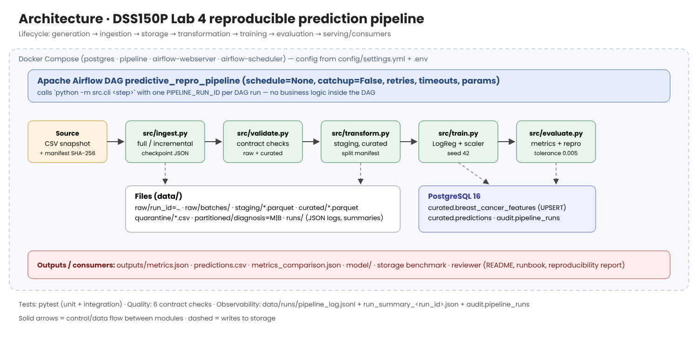

# DSS150P Lab 4 · Reproduction of a Predictive Analytics Project

**Student:** Claudia González Martín · **Course:** DSS150P Fundamentals of Data Engineering

A breast-cancer classifier (malignant vs benign) rebuilt as a reproducible, rerun-safe data product:
checksummed source → raw → staging → curated → PostgreSQL → model → predictions/metrics, orchestrated by Apache Airflow,
with data contract, quality checks, tests and an automatic baseline comparison.

> **Baseline note.** I am an Erasmus student and did not take Predictive Analytics last term, so I have no group project.
> As agreed with the instructor, I used another work: a public dataset (Breast Cancer Wisconsin, UCI, CC BY 4.0) and the
> notebook-style analysis in `baseline/reference_analysis.py`. Details in [docs/reproducibility_report.md](docs/reproducibility_report.md).

| Result | Baseline | Reproduced |
|---|---|---|
| Accuracy (primary) | 0.9649 | 0.9649 |
| F1 / ROC-AUC | 0.9512 / 0.9960 | 0.9512 / 0.9960 |



## 1. Prerequisites
Git, Docker Desktop (Compose v2). Python 3.11 only for host-side runs and tests.

## 2. Setup from a clean clone
```bash
git clone <this repo> && cd <repo>
cp .env.example .env            # PowerShell: Copy-Item .env.example .env   (then set POSTGRES_PASSWORD)
docker compose up -d postgres   # PostgreSQL 16 on host port 5433; creates databases dss150p and airflow
docker compose run --rm pipeline python -m src.cli validate-env
```
Host-side (optional): `python -m venv .venv`, activate it, `pip install -r requirements.txt`. Host commands use
`localhost:5433` from `.env`.

## 3. Data placement and identity
The source is included (public, CC BY 4.0): `data/source/breast_cancer_wisconsin.csv`, 569 rows × 32 columns.
Its SHA-256 is in [metadata/source_manifest.yml](metadata/source_manifest.yml) and is checked at every ingestion.
Manual check: `sha256sum data/source/breast_cancer_wisconsin.csv` (PowerShell: `Get-FileHash data\source\breast_cancer_wisconsin.csv`).
`scripts/export_source.py` documents how the file was exported from scikit-learn (not needed to run the pipeline).
Profile: [metadata/source_profile.md](metadata/source_profile.md) · contract: [metadata/data_contract.yml](metadata/data_contract.yml).

## 4. Running the pipeline
One command per step (inside Docker: `docker compose run --rm pipeline python -m src.cli <command>`):

| Command | Step |
|---|---|
| `ingest [--mode full\|incremental] [--max-batches N] [--force]` | Full copy to `data/raw/run_id=<id>/`, or checkpointed batches in `data/raw/batches/` |
| `validate-raw` | Contract schema/type check; stops the pipeline on violation |
| `transform` | Staging Parquet + quarantine CSV |
| `build-curated` | Model-ready Parquet, deterministic split (verified against `metadata/split_manifest.json`), partitions by diagnosis |
| `load` | UPSERT into `curated.breast_cancer_features` (rerun inserts 0 rows) |
| `validate-curated` | Schema, completeness, uniqueness, validity, business rule, predictive integrity + PostgreSQL duplicate check |
| `train` / `evaluate` | Model, `outputs/predictions.csv`, `outputs/metrics.json` |
| `repro-check` | `outputs/metrics_comparison.json`, fails if outside tolerance 0.005 |
| `publish` | Predictions UPSERT + run record in `audit.pipeline_runs` |
| `run-all` | All of the above in order |
| `benchmark`, `load-partition --diagnosis M` | Storage experiment and single-partition load |

Every step logs a JSON line (timestamp, pipeline_run_id, stage, rows, duration, error) to `data/runs/pipeline_log.jsonl`
and updates `data/runs/run_summary_<run_id>.json` (raw/staging/curated/train/test/prediction counts, status).

## 5. Airflow
```bash
docker compose up airflow-init
docker compose up -d airflow-webserver airflow-scheduler
```
Open http://localhost:8081 (admin / admin), unpause `predictive_repro_pipeline` and use **Trigger DAG w/ config**.

`ingest_source → validate_raw → transform_staging → build_curated → load_postgres → validate_curated → train_model → evaluate_model → reproducibility_check → publish_outputs`

- `schedule=None` (static, checksummed snapshot: runs are triggered manually when code/config/source change) and `catchup=False`.
- Retries 2 × 20 s on retry-safe tasks; no retries on validation/reproducibility checks (same input → same failure).
- `execution_timeout` on every task (5 min for training); failure/retry callbacks write context to `data/runs/airflow_events.jsonl`.
- Same `PIPELINE_RUN_ID = {{ run_id }}` for every task.

| Param | Values |
|---|---|
| `ingest_mode` | `full` / `incremental` |
| `model_seed` | integer, default 42 (another seed is expected to fail the reproducibility check) |
| `inject_bad_data` | `true` = ingest a temporary copy without `mean_area` → fails at `validate_raw`, nothing reaches the model |
| `fail_task`, `failure_mode` | inject a failure in any task, `once` (recovers on retry) or `always` |

## 6. Validation and tests
```bash
docker compose run --rm pipeline python -m pytest -v
```
5 unit tests (checksum, staging cleaning/quarantine, record hash, deterministic split, quality checks detect invalid data) and
3 integration tests (incremental rerun without duplicates, bad copy stopped before the model, end-to-end rerun idempotent and reproducible).

Duplicate check after two runs:
`SELECT count(*), count(DISTINCT record_id) FROM curated.breast_cancer_features;` → `569 | 569`.

## 7. Expected outputs
`outputs/metrics.json`, `outputs/predictions.csv` (114 test rows), `outputs/metrics_comparison.json` (`"passed": true`),
`outputs/model/model_config.json`, PostgreSQL tables `curated.breast_cancer_features`, `curated.predictions`,
`audit.pipeline_runs`, `audit.partition_loads`, views `curated.v_class_balance`, `curated.v_prediction_quality`.

## 8. Troubleshooting
See [docs/runbook.md](docs/runbook.md). Most common: missing `.env`, port 5433/8081 in use, checksum mismatch, permission
errors on generated folders (delete the generated folder and rerun).

## 9. Repository structure
Follows section 6 of the lab guide (`config/`, `data/source`, `metadata/`, `src/`, `sql/`, `dags/`, `tests/`, `outputs/`, `docs/`).
Additions: `src/db.py` (PostgreSQL access) and `src/observability.py` (run id, logging, summaries), `sql/init/` (database
creation), `baseline/` (the reference analysis), `scripts/` (source export provenance).

Docs: [architecture](docs/architecture.png) · [lineage](docs/lineage.png) · [runbook](docs/runbook.md) ·
[benchmark report](docs/benchmark_report.md) · [reproducibility report](docs/reproducibility_report.md) · [run evidence](docs/RUN_EVIDENCE.md)

## 10. Use of AI tools
I used an AI assistant (Claude, by Anthropic) to help with parts of the code and documentation. I ran everything on my own
machine, checked the results and I am responsible for the submission.
